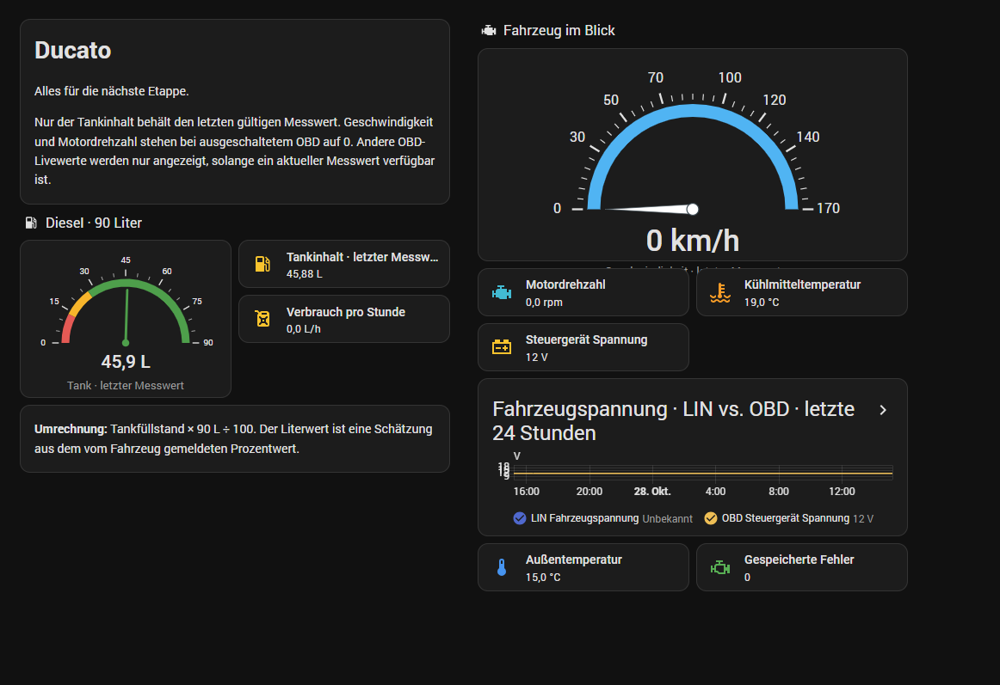
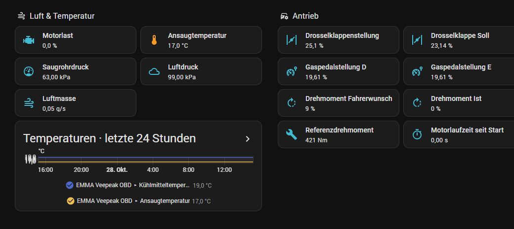

# EMMA BLE OBD Bridge

Bring vehicle data from a Bluetooth LE OBD-II adapter into Home Assistant. EMMA polls an ELM-compatible adapter, discovers sensors through MQTT, and keeps the last valid values available while the vehicle is parked. The project started with a Veepeak OBDCheck BLE in a Fiat Ducato camper.

[Download and release notes](https://github.com/Omasprintfarm-de/ha-ble-obd-bridge/releases/tag/v0.1.3) · [Report an issue](https://github.com/Omasprintfarm-de/ha-ble-obd-bridge/issues) · [Sponsor the project](https://github.com/sponsors/Omasprintfarm-de)

## Ducato dashboard in Home Assistant

The overview shows how EMMA's OBD sensors can feed a camper dashboard. The 90-litre gauge was a custom estimate for this Ducato. EMMA publishes the fuel percentage when the vehicle provides it. The voltage comparison also uses a separate LIN sensor.

The engine view shows additional values from the same setup, including intake air temperature, manifold pressure, airflow and torque. These are screenshots from the project vehicle. Build your own cards from the MQTT sensors available on your vehicle.

## Features

| Feature | What it provides |
| --- | --- |
| Core readings | Engine speed, vehicle speed, coolant temperature, ECU voltage and adapter identification. |
| Additional sensors | Depending on the vehicle, examples include fuel level, fuel rate, intake temperature, engine load and torque. |
| MQTT Discovery | Home Assistant creates sensors automatically. Each reading has a `last_valid_measurement` timestamp. |
| Last valid values | Readings are retained and cached across restarts. Check their timestamps when the vehicle is parked. |
| Automatic reconnect | The app retries after a BLE disconnect or an OBD timeout. |
| Flight recorder | Rotating local JSONL files keep timestamps, raw ELM responses and communication errors. |
| Read-only vehicle access | The app uses ELM setup commands and an allowlist of OBD read requests. |

## Hardware and compatibility

- Home Assistant OS on **ARM64** with a local Bluetooth adapter.
- An MQTT broker and the **MQTT integration** enabled in Home Assistant.
- An ELM-compatible **Bluetooth LE** OBD adapter. Bluetooth Classic, Wi-Fi and USB adapters require different transports.

| BLE profile | Verification |
| --- | --- |
| `fff0` | Automatic profile selection and an ELM response verified with a physical Veepeak OBDCheck BLE on HAEmma. |
| `ffe0` | Profile selection verified in simulation. |
| `nordic_uart` | Profile selection verified in simulation. |

The public beta passed its [ARM64 image build and ELM simulation tests](https://github.com/Omasprintfarm-de/ha-ble-obd-bridge/actions/runs/45048255081). A fresh vehicle-data test of the public package is still pending.

## Installation

1. In Home Assistant, open **Settings → Apps → App store**. Open the three-dot menu, choose **Repositories**, and add `https://github.com/Omasprintfarm-de/ha-ble-obd-bridge`.
2. Install **EMMA Veepeak OBD**. In its **Configuration** tab, enter your adapter's Bluetooth address in `ble_address` and leave `ble_profile` on `auto`.
3. Set up MQTT. With the Supervisor-provided MQTT service available, leave `mqtt_username` empty. For a separately configured broker, enter its host, port and credentials.
4. Plug in the adapter, switch on the ignition while the vehicle is parked, and disconnect any phone app or head unit using the adapter. Start EMMA and open its **Log** tab.
5. After the adapter and ECU answer, open **Settings → Devices & services → MQTT** and check for **EMMA Veepeak OBD**. Add its entities to your dashboard.

## Configuration

| Option | Default | Use |
| --- | --- | --- |
| `ble_address` | Empty | Required. Enter the Bluetooth address of your own adapter. |
| `ble_profile` | `auto` | Detect a supported profile or select `fff0`, `ffe0` or `nordic_uart`. |
| `mqtt_host`, `mqtt_port` | `core-mosquitto`, `1883` | Broker address and port when supplying your own MQTT credentials. |
| `mqtt_username`, `mqtt_password` | Empty | Explicit broker credentials. An empty username selects Supervisor MQTT discovery. |
| `mqtt_prefix` | `emma/obd` | Prefix for published MQTT data and status topics. |
| `poll_seconds` | `5` | Pause between core polling cycles. Accepted range is 2–60 seconds. |

## Troubleshooting

| What you see | What to check |
| --- | --- |
| BLE connection times out | Check adapter power, Bluetooth address and range. Move the Home Assistant host closer and disconnect other BLE clients. |
| `No compatible BLE OBD characteristics` | Check the adapter's BLE profile. Share its model and available service UUIDs when reporting a compatibility issue. |
| The adapter identifies itself, then `0100` returns `UNABLE TO CONNECT` | BLE is working. Check the ignition and OBD connection to the vehicle ECU. |
| A reading remains visible after parking | Check `last_valid_measurement` on the entity. It shows when the last valid value was received. |
| OBD responses appear in the log, but there are no entities | Check the MQTT broker connection and Home Assistant MQTT Discovery. |

The flight recorder writes to `/share/OBD_Captures/obd_flight.jsonl`. It rotates at 8 MiB and keeps seven older files. Check recordings for vehicle identifiers and private telemetry before posting them to a public issue.

## Development and support

Run `python -m unittest discover -s tests -v` from the repository root. The tests cover BLE profile selection, simulated ELM responses, timeout handling, the command allowlist and MQTT/cache behavior. The [ARM64 GitHub Actions workflow](.github/workflows/arm64.yml) also builds the Home Assistant image.

If you try a different adapter, include its model, vehicle model year, BLE profile and the measurements you verified in an [issue](https://github.com/Omasprintfarm-de/ha-ble-obd-bridge/issues). You can support documentation and hardware testing through [GitHub Sponsors](https://github.com/sponsors/Omasprintfarm-de).

### Help verify Fiat Ducato Gen 9 AdBlue readings

AdBlue level for the Ducato Gen 9 (model year 2025 onward) is open for validation. If your diagnostic app already shows a plausible level, [submit an AdBlue test report](https://github.com/Omasprintfarm-de/ha-ble-obd-bridge/issues/new?template=ducato-adblue.md). If you can, capture the same reading at two different fill levels, such as before and after a normal refill. Include the command and raw reply if your diagnostic app exposes them, plus the value shown by the app and any corresponding dashboard reading.

A report with the raw data and a repeatable change gives us a candidate to check. An independent result from a second vehicle or tool helps distinguish a reusable decoder from a vehicle-specific mapping. Share only the relevant excerpts with vehicle identifiers removed.

Licensed under the [MIT License](LICENSE).
